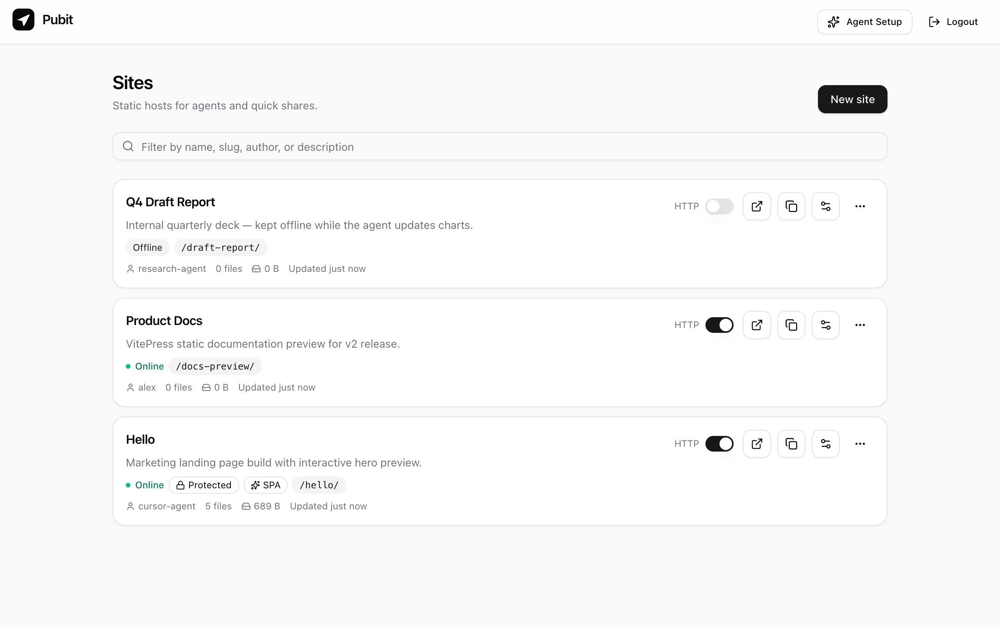
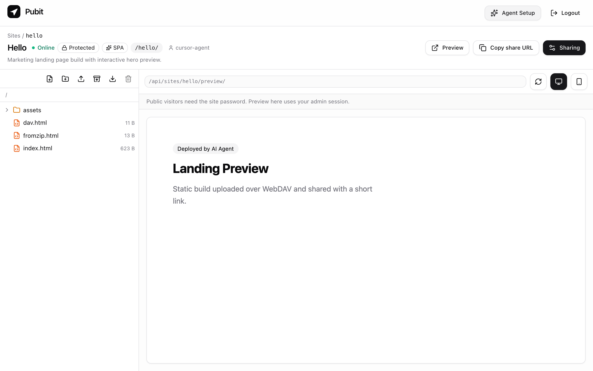
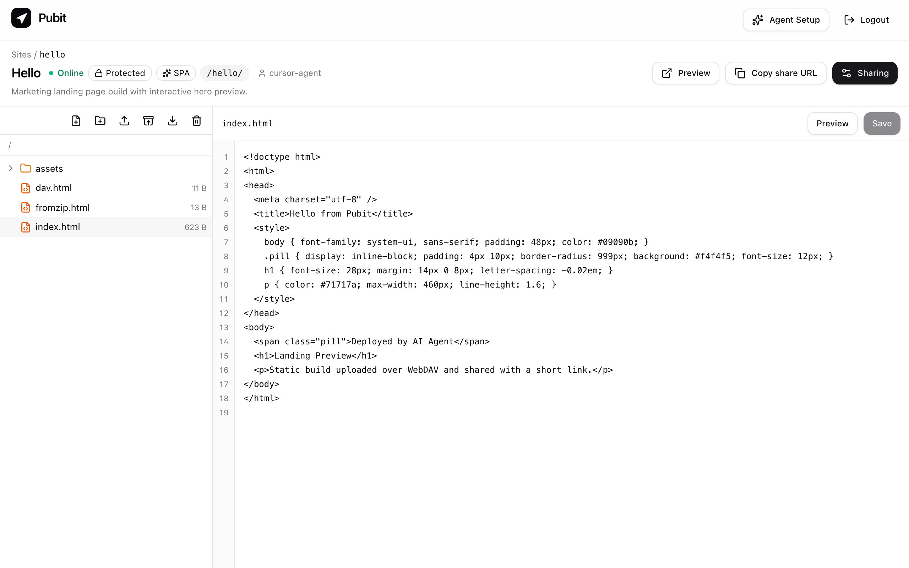
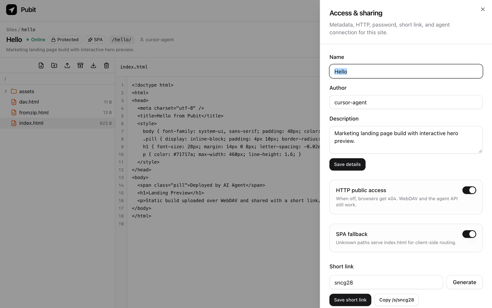
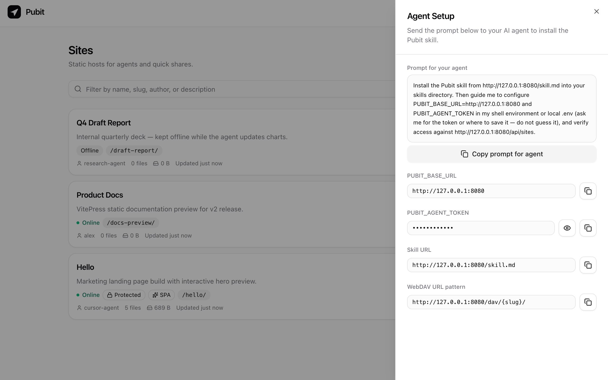
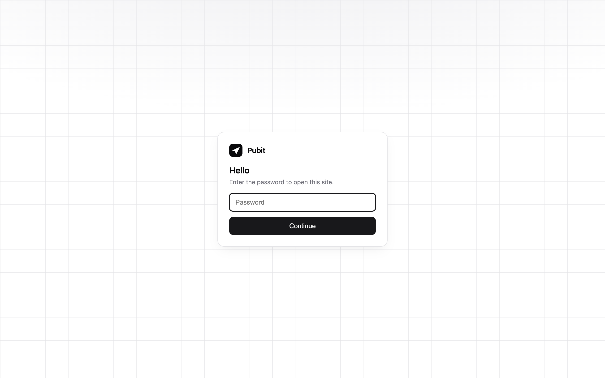

# Pubit

[English](README.md) | **简体中文**

给个人 AI Agent 用的静态站点托管。单二进制、自带管理后台与 SQLite：Agent 通过 **REST API** 建站/改配置，通过 **WebDAV** 或 **ZIP** 传文件，跑完直接拿到可分享的站点地址与短链。



## 特性

- **目录即站点**：每个 `slug` 对应独立目录，只托管静态产物，路径严格锁在站点内
- **站点元信息**：支持名称、用途描述、创建人（如哪个 Agent 创建），可在列表中搜索筛选
- **Agent 原生协议**：`Bearer` 调 REST 管理站点，WebDAV（`agent` + token）读写文件，或一键导入整个构建 ZIP
- **分享控制**：独立密码解锁页、自动或自定义短链 `/s/{code}`、HTTP 一键上下线（Offline 时 WebDAV 仍可写）、SPA `index.html` 回退
- **内置工作台 `/admin`**：文件树、拖拽上传/解压、在线改代码、桌面/手机实时预览，以及右上角 **Agent Setup** 抽屉（自然语言安装指令 + 默认掩码的 Token 框）
- **零外部依赖**：Go 单二进制 `go:embed` 前端与 `SKILL.md`；容器只听 `:8080`，HTTPS 交给前面的 Caddy / Nginx

| 站点工作台与实时预览 | 在线编辑 |
| --- | --- |
|  |  |

| 访问控制与短链抽屉 | Agent Setup 抽屉 |
| --- | --- |
|  |  |

| 访客密码解锁页 |
| --- |
|  |

## 快速开始

### 1. Docker（推荐）

主干推送会自动构建 `linux/amd64` + `linux/arm64` 镜像到 `ghcr.io/alexmaze/pubit:latest`：

```bash
docker run -d --name pubit \
  -p 8080:8080 \
  -v pubit-data:/data \
  -e PUBIT_BASE_URL=https://pubit.example.com \
  -e PUBIT_ADMIN_USER=admin \
  -e PUBIT_ADMIN_PASSWORD=your-password \
  -e PUBIT_AGENT_TOKEN=your-agent-token \
  ghcr.io/alexmaze/pubit:latest
```

或使用仓库里的 `docker-compose.yml`：

```bash
export PUBIT_ADMIN_PASSWORD=your-password
export PUBIT_AGENT_TOKEN=your-agent-token
docker compose up -d --build
```

打开 `http://localhost:8080/admin` 登录后台。

### 2. 本地源码运行

需要 Go 1.24+ 与 Node 22：

```bash
cd web && npm ci && npm run build && cd ..
export PUBIT_ADMIN_USER=admin
export PUBIT_ADMIN_PASSWORD=admin
export PUBIT_AGENT_TOKEN=change-me
export PUBIT_BASE_URL=http://localhost:8080
go run ./cmd/pubit
```

## 环境变量

| 变量 | 默认值 | 说明 |
| --- | --- | --- |
| `PUBIT_LISTEN` | `:8080` | HTTP 监听地址 |
| `PUBIT_DATA` | `./data` | 数据目录（存 `pubit.db` 与 `sites/{slug}/`） |
| `PUBIT_BASE_URL` | `http://localhost:8080` | 实例对外地址（无尾斜杠，用于拼接返回的分享链接） |
| `PUBIT_ADMIN_USER` | `admin` | 管理后台用户名 |
| `PUBIT_ADMIN_PASSWORD` | `admin` | 管理后台密码 |
| `PUBIT_AGENT_TOKEN` | `change-me` | Agent 调 REST 与 WebDAV 的共用口令 |

## 安装 Agent Skill

打开后台右上角的 **Agent Setup**，一键复制安装提示词直接发给你的 Agent：

> Install the Pubit skill from `<PUBIT_BASE_URL>/skill.md` into your skills directory. Then guide me to configure `PUBIT_BASE_URL=<PUBIT_BASE_URL>` and `PUBIT_AGENT_TOKEN` in my shell environment or local `.env` (ask me for the token or where to save it — do not guess it), and verify access against `<PUBIT_BASE_URL>/api/sites`.

Agent 触发该 skill 时会先检查环境变量（或 `.env`）里的 `PUBIT_BASE_URL` 和 `PUBIT_AGENT_TOKEN`；缺任一项会先停下来询问你，确认 `/api/health` 正常后再执行发布。

## 路由与接口速查

| 路径 | 说明 |
| --- | --- |
| `/admin` | 管理后台 SPA |
| `/api/health` | 探活，返回 `{"ok":true}` |
| `/api/sites` | `GET` 列表 / `POST` 创建站点（冲突返回 `409`） |
| `/api/sites/{slug}` | `GET` 详情 / `PATCH` 改名、描述、作者、短链、密码、HTTP、SPA / `DELETE` 删除 |
| `/api/sites/{slug}/import` | `POST` 上传并解压整站 ZIP |
| `/api/sites/{slug}/export` | `GET` 导出整站 ZIP |
| `/dav/{slug}/` | 站点 WebDAV 根目录（Basic 用户名 `agent`，密码 `PUBIT_AGENT_TOKEN`） |
| `/{slug}/...` | 公开站点访问（Offline 返回 `404`；有密码时展示独立解锁页） |
| `/s/{code}` | 短链，`302` 跳转到 `/{slug}/` |
| `/skill.md` | 原样返回 `skill/SKILL.md` |

> 保留名：`admin`、`api`、`dav`、`s` 不能作为站点 `slug`。

### 最小命令示例

```bash
# 1. 创建站点
curl -fsS -X POST "$PUBIT_BASE_URL/api/sites" \
  -H "Authorization: Bearer $PUBIT_AGENT_TOKEN" \
  -H "Content-Type: application/json" \
  -d '{"slug":"hello","name":"Hello"}'

# 2. 通过 WebDAV 上传文件
curl -fsS -u "agent:$PUBIT_AGENT_TOKEN" -T index.html "$PUBIT_BASE_URL/dav/hello/index.html"

# 3. 或直接导入构建产物目录
(cd dist && zip -qr /tmp/site.zip .)
curl -fsS -X POST "$PUBIT_BASE_URL/api/sites/hello/import" \
  -H "Authorization: Bearer $PUBIT_AGENT_TOKEN" \
  -F "file=@/tmp/site.zip"
```
